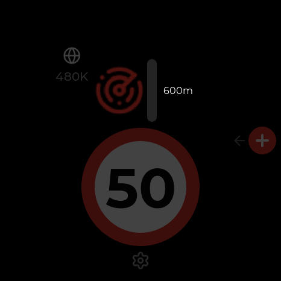
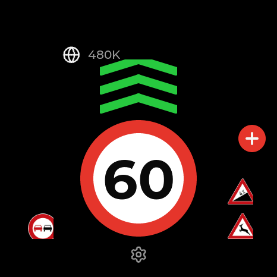

# BlitzerdeDsp

Open-source firmware for a dedicated in-car AMOLED display: speed limits, hazard / speed-camera
warnings, context traffic signs, and a touch reporting UI. All live data arrives over Bluetooth LE
from a companion smartphone app — **the board never talks to an external API**. It renders the
state it receives and emits raw interaction events.

<p align="center">
  
  
  
  
</p>

- **Target board:** Waveshare **ESP32-C6-Touch-AMOLED-1.43** (466×466 round AMOLED, no PSRAM). See
  [`docs/hardware.md`](docs/hardware.md).
- **Stack:** ESP-IDF ≥ 5.3, LVGL 9, C++17, NimBLE, hand-rolled CBOR.
- **Status:** the display side is feature-complete and runs on the real board — full UI (Home,
  hazard / confirm overlays, Melden crown, Settings, pairing), a NimBLE GATT peripheral with eight
  characteristics (state, events, device info, settings, time, UI feature switches, **OTA firmware
  update**, SD asset upload), microSD, audio (event chimes + composed voice announcements,
  app-adjustable volume), offline cache and persisted settings. What is still unverified on
  hardware (OTA end-to-end, UiConfig write, …) is listed in
  [`docs/project-summary.md`](docs/project-summary.md); bring-up notes in
  [`docs/firmware-bringup.md`](docs/firmware-bringup.md).

> **Legal notice (draft — pending legal review).** The device only shows what its companion app
> sends. It *can* show speed-camera / hazard warnings if — and only if — the app is told to send
> them, which the user must switch on explicitly. In several countries, including Germany (§ 23
> StVO — `TODO(verify)` exact paragraph), using a device designed to warn of traffic enforcement
> while driving is prohibited; other countries have stricter or different rules. Build with
> `CONFIG_BDSP_FEATURE_SPEEDCAM=n` for firmware with no speed-camera code at all. You are
> responsible for obeying the law where you drive. Full draft:
> [`docs/legal-notice-draft.md`](docs/legal-notice-draft.md).

> The companion **Flutter app is not in this repo**. This repo defines the BLE protocol
> ([`docs/ble-protocol.md`](docs/ble-protocol.md)), an interactive Python test console that
> replaces the app for now ([`tools/fake_app.py`](tools/fake_app.py) — see
> [`docs/testing.md`](docs/testing.md)), and a tested Dart protocol package ([`protocol/dart/`](protocol/dart/)) with the BLE contract in [`docs/contract/`](docs/contract/) — start at [`docs/app-integration.md`](docs/app-integration.md).

## Pairing the display with the app

1. Power the display. On first boot (and after *Settings → Zurücksetzen*) it shows
   **"Verbinde dein Mobilgerät"**. *Handy verbinden* opens a QR code that leads to this page, with the
   three steps: *Bluetooth einschalten · mit "BlitzerdeDsp" verbinden · App öffnen*.
2. In the companion app choose the display — it advertises the service UUID from
   [`docs/ble-protocol.md`](docs/ble-protocol.md) and the name `BlitzerdeDsp` — and connect. There is
   **no PIN**: the app connects directly over BLE, and once it streams state the display leaves the
   pairing screen.
3. The display keeps its last state across ignition cycles and re-advertises whenever the app is gone;
   the app reconnects on its own and restarts its sequence numbers (see the connect sequence in the
   protocol document).
4. No phone app yet? Use the PC test console: `pip install bleak cbor2`, then
   `python tools/fake_app.py` (GUI) — details in [`docs/testing.md`](docs/testing.md).
5. Security note: today any BLE device in range can connect (no encryption or passkey is required).
   That is a documented, accepted limitation of protocol v1 — see
   [`docs/ble-protocol.md`](docs/ble-protocol.md), *Security level*.

## Repository layout

| Path | Contents |
|---|---|
| `core/` | Platform-independent logic — model, state machine, CBOR codec, cache, settings, audio. Host-compilable, LVGL-free. |
| `ui/` | LVGL screens, widgets, theme, i18n, generated font/sign/icon assets. No IDF/SDL includes. |
| `hal/` | Hardware abstraction interfaces. |
| `transport/` | `ITransport` + Mock (demo/sim). |
| `sim/` | Desktop build of `ui/` + `core/` against LVGL-SDL — the fast iteration path. |
| `test/` | Host unit tests (CTest, doctest). |
| `firmware/` | The ESP-IDF application + ESP-specific HAL / BLE transport. |
| `tools/` | Asset pipelines (fonts, signs, icons, audio), `fake_app.py`. |
| `docs/` | `architecture.md`, `hardware.md`, `ui-spec.md`, `firmware-bringup.md`, `testing.md`, `audio-assets.md`; the BLE contract — `ble-protocol.md`, [`contract/`](docs/contract/), `app-integration.md`, `compatibility.md`; updates — `release-format.md`, `update-authenticity.md`. |
| `protocol/dart/` | `tn_display_protocol` — pure-Dart implementation of the BLE protocol (no Flutter, no Bluetooth), tested against the golden vectors. |

Read [`docs/architecture.md`](docs/architecture.md) first — the guiding rule is *the display
renders, it never computes*.

## Build — host (tests + simulator), no hardware

Needs a C++17 compiler, CMake ≥ 3.20, Ninja, and SDL2 (simulator only).

```bash
cmake -S . -B build -G Ninja -DCMAKE_BUILD_TYPE=Debug
cmake --build build
ctest --test-dir build --output-on-failure
```

Run the simulator (mouse = touch):

```bash
./build/sim/bdsp_sim            # keys 1-9 = scenarios, d = demo timeline, s = screenshot
./build/sim/bdsp_sim --demo     # start in the mock demo (audible warnings)
./build/sim/bdsp_sim --shot     # headless: write docs/screenshots/*.png
```

Platform notes for the host toolchain (incl. an antivirus-TLS workaround for Windows/MSYS2) are in
[`docs/building.md`](docs/building.md).

## Build — firmware

Needs ESP-IDF ≥ 5.3.

```bash
cd firmware
idf.py set-target esp32c6
idf.py build flash monitor
```

Feature flags are Kconfig options under **BlitzerdeDsp** (`idf.py menuconfig`), notably
`CONFIG_BDSP_FEATURE_SPEEDCAM` — turn it off for a build with no speed-camera code at all
(see the legal notice above).

Drive the flashed board over BLE from a PC (no phone app needed):

```bash
pip install bleak cbor2
python tools/fake_app.py --repl        # interactive console; --all for a scripted pass
```

Full checklist in [`docs/testing.md`](docs/testing.md).

## Assets

All regenerable; the generated outputs are committed so a plain `cmake` build needs no extra tools.

| Asset | Script | Source |
|---|---|---|
| Montserrat fonts | `tools/gen_fonts.sh` | JulietaUla/Montserrat (OFL) |
| Traffic signs | `tools/signs/*` + `tools/gen_assets.sh` | Wikimedia Commons German StVO (public domain) |
| UI icons | `tools/gen_assets.sh` | Lucide (ISC) |
| Audio | `tools/gen_audio_tones.py`, `tools/gen_voice.py` | synthetic tones (committed); German voice clips are **generated locally and not distributed** — see below |

Voice announcements need their phrase clips on the microSD card (`/audio/voice/de/*.wav`). They are
**not part of this repository** (the placeholders are Windows-SAPI text-to-speech output; their
redistribution terms are unclear). Generate them with `python tools/gen_voice.py` (Windows) or supply
your own recordings — same filenames, 16 kHz mono 16-bit — then `python tools/gen_voice.py --upload`
or copy `tools/sd_root/` to the card. Without the clips the device still works: a voice cue
degrades to the event chime. See [`docs/audio-assets.md`](docs/audio-assets.md).

## License

MIT — see [`LICENSE`](LICENSE). Third-party code, assets and their licenses: [`THIRD_PARTY.md`](THIRD_PARTY.md).
